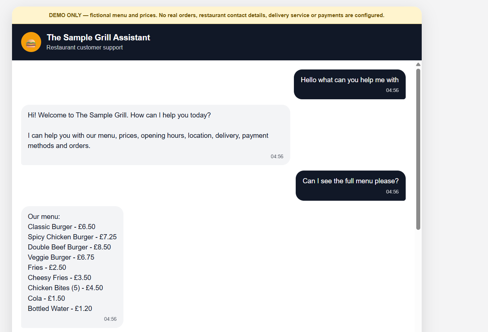
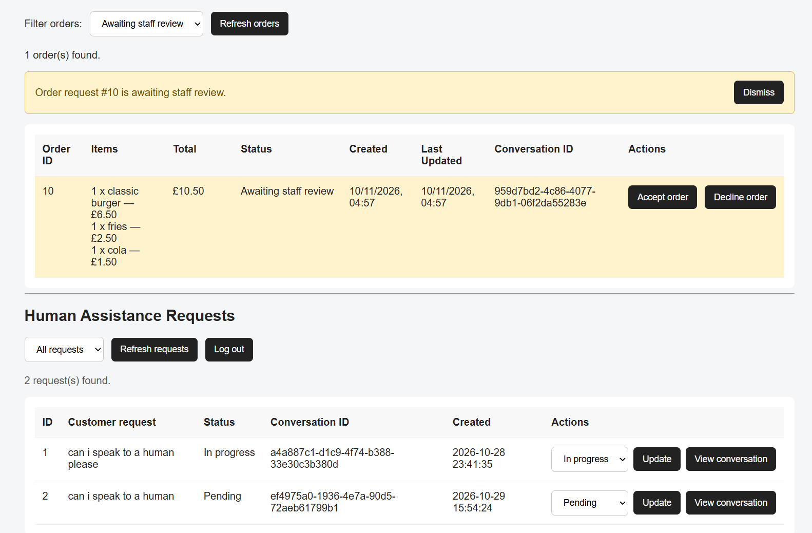

# Business AI — Restaurant Chatbot Demo

An AI-powered restaurant customer service and order-management demonstration built with Python, Flask, SQLite and the OpenAI API.

The project demonstrates how an AI chatbot can handle customer enquiries, assist with order creation and connect customers with restaurant staff through a dedicated dashboard.

**This is a demonstration application using a fictional restaurant, The Sample Grill. It is not connected to a real restaurant and must not be used to accept real orders or payments.**

## Features

### Customer chatbot

\- AI-powered responses to customer enquiries.

\- Answers questions using restaurant information such as menu items, opening hours, delivery and payment information.

\- Supports adding, removing and modifying items in an order.

\- Calculates order totals using integer pence to avoid floating-point currency errors.

\- Maintains conversation history.

## Screenshots

### Customer Chatbot

The customer-facing chatbot supports restaurant enquiries,
menu browsing and order placement.



### Staff Dashboard

The staff dashboard allows restaurant staff to review
orders, manage requests and respond to customers.



### Order management

\- Customers can submit order requests.

\- Submitted requests enter a `pending\_review` state.

\- Orders are stored persistently in SQLite.

\- Staff can accept or decline pending requests.

\- Customers can enquire about their order status.

### Staff dashboard

\- Staff login with password-hash authentication.

\- View and filter customer order requests.

\- Review and manage pending orders.

\- View customer assistance requests.

\- Respond to customers through the staff interface.

### Human assistance

\- Customers can request help from a staff member.

\- Handoff requests are recorded in the database.

\- Staff can view conversations and send replies.

\- Conversation messages remain available when reopening a request.

## Technology Stack

| Technology | Purpose |

|---|---|

| Python | Application logic |

| Flask | Backend web framework |

| OpenAI API | AI-powered intent detection and responses |

| SQLite | Persistent application data |

| HTML and CSS | Frontend structure and styling |

| JavaScript | Chat interface and dashboard interactions |

| pytest | Automated Python testing |

| Playwright | Browser-based testing |

| GitHub Actions | Continuous integration |

## Application Architecture

The application separates AI interpretation from business logic.

1\. A customer submits a message through the chatbot interface.

2\. Flask receives the request.

3\. The OpenAI API helps interpret the customer's intent.

4\. Python validates the requested action against the application's supported functionality and menu data.

5\. Validated operations update the order or conversation data in SQLite.

6\. The customer receives a response through the chat interface.

Staff use a separate authenticated dashboard to review orders and manage customer assistance requests.

## Project Structure

```text

BusinessAI\_UK\_Demo/

│

├── .github/

│   └── workflows/

│       └── tests.yml

│

├── restaurant\_automated\_tests/

│   └── tests/

│       ├── test\_business\_ai.py

│       ├── test\_order\_workflow.py

│       └── test\_playwright\_customer.py

│

├── templates/

│   ├── index.html

│   ├── login.html

│   └── staff.html

│

├── app.py

├── db.py

├── restaurant\_data.py

├── init\_database.py

├── requirements.txt

├── .env.example

└── README.md

```

## Running Locally

### Requirements

\- Python 3.14 or a compatible Python environment.

\- An OpenAI API key.

\- Git.

### 1. Clone the repository

```bash

git clone https://github.com/mabdalla-dev/business-ai-uk-demo.git

cd business-ai-uk-demo

```

### 2. Create a virtual environment

On Windows PowerShell:

```powershell

python -m venv .venv

.\\.venv\\Scripts\\Activate.ps1

```

### 3. Install dependencies

```powershell

python -m pip install --upgrade pip

pip install -r requirements.txt

```

### 4. Configure environment variables

The application uses environment variables for configuration.

The `.env.example` file documents the required variables. Configure them in your terminal or deployment environment.

Example for Windows PowerShell:

```powershell

$env:SECRET\_KEY = "replace-with-a-secure-secret"

$env:OPENAI\_API\_KEY = "your-openai-api-key"

$env:OPENAI\_MODEL = "gpt-6-luna"

$env:STAFF\_USERNAME = "admin"

```

Generate a password hash:

```powershell

python -c "from werkzeug.security import generate\_password\_hash; print(generate\_password\_hash('your-password'))"

```

Set the resulting hash:

```powershell

$env:STAFF\_PASSWORD\_HASH = "paste-generated-hash-here"

```

Use your own credentials. Never commit real API keys, passwords or secret values.

### 5. Start the application

```powershell

python app.py

```

Open the customer chatbot:

```text

http://127.0.0.1:5000/

```

Staff login:

```text

http://127.0.0.1:5000/staff/login

```

## Automated Testing

The project includes Python tests for business logic and order workflows, alongside Playwright browser tests.

### Python tests

```powershell

python -m pytest -v restaurant\_automated\_tests/tests/test\_business\_ai.py restaurant\_automated\_tests/tests/test\_order\_workflow.py

```

### Playwright tests

Start the Flask application in a separate terminal, then run:

```powershell

python -m playwright install chromium

python -m pytest -v restaurant\_automated\_tests/tests/test\_playwright\_customer.py --browser chromium

```

### Current test coverage

| Test suite | Tests passing |

|---|---:|

| Business logic and order workflow | 25 |

| Playwright browser tests | 10 |

| **Total** | **35** |

These results reflect the project's local test runs during development.

## Continuous Integration

GitHub Actions is configured to run automated tests when changes are pushed to the `main` branch or submitted through pull requests.

The workflow contains separate jobs for:

\- Python and order workflow tests.

\- Playwright browser tests using Chromium.

## Demonstration Limitations

\- The Sample Grill is fictional.

\- Menu items, prices and restaurant information are demonstration data.

\- The application does not process payments.

\- Submitted orders are demonstration requests, not genuine restaurant orders.

\- Real-world use would require restaurant-approved information, appropriate security, privacy and data-retention arrangements, and deployment configuration.

## Future Improvements

Potential areas for further development include:

\- API rate limiting and stronger abuse protection.

\- Conversation-history limits and improved context management.

\- Additional API and end-to-end tests.

\- Production deployment and monitoring.

\- Improved data-retention controls.

\- Further staff dashboard functionality.
